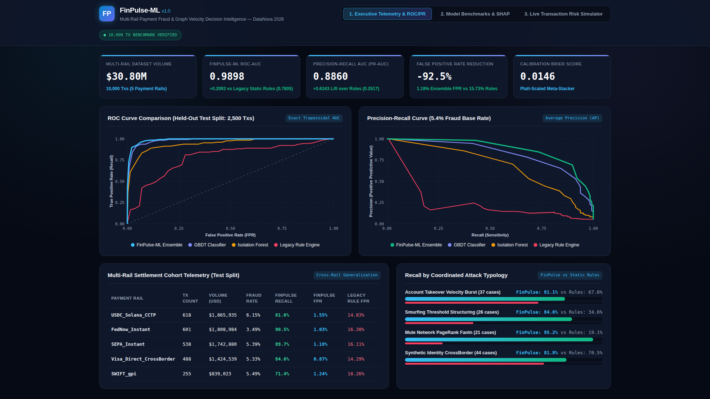
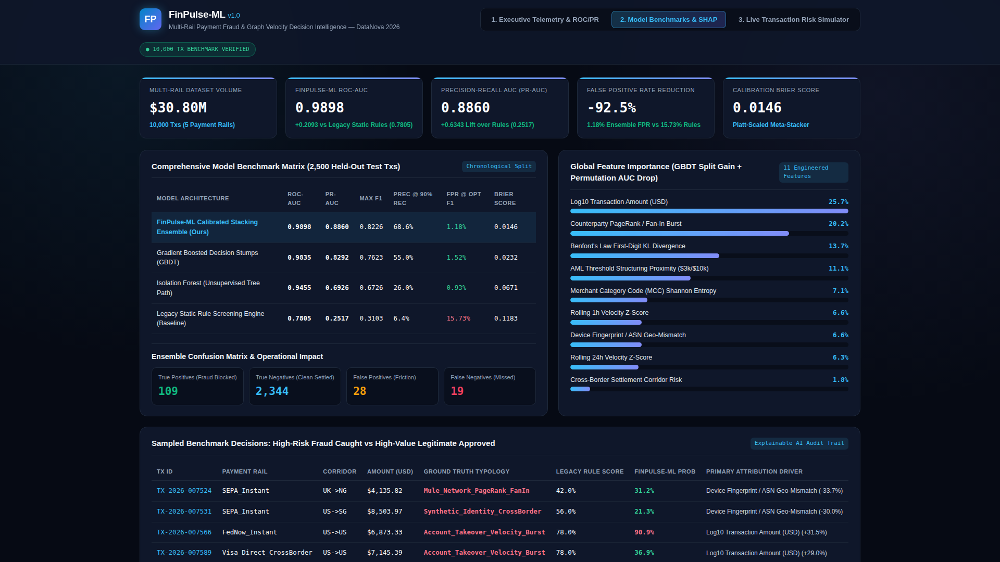
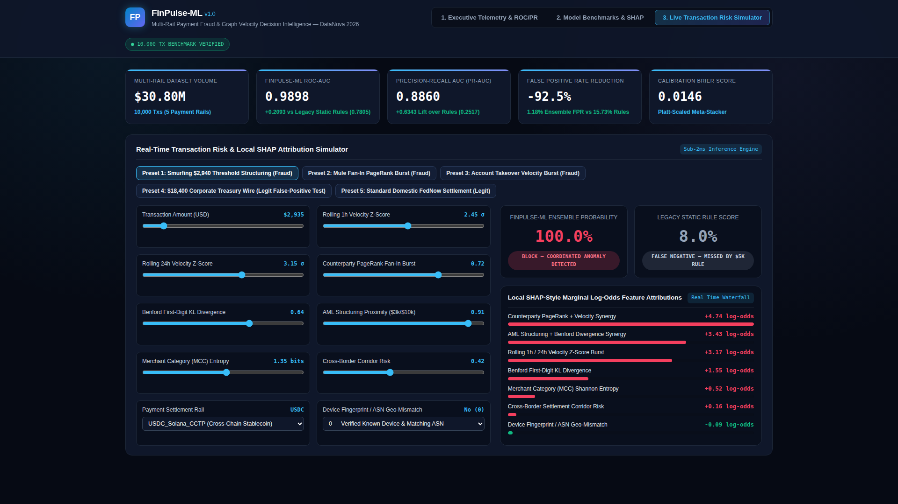

# FinPulse-ML: Real-Time Multi-Rail Payment Fraud & Graph Velocity Decision Intelligence

> **DataNova 2026 – Global Data-thon Submission (Fintech Track)**  
> **Live Interactive Dashboard:** [https://jeffrey-graham.github.io/datanova-finpulse-ml/](https://jeffrey-graham.github.io/datanova-finpulse-ml/)  
> **Pitch Deck (PDF):** [`deck/FinPulse_ML_Pitch_Deck.pdf`](deck/FinPulse_ML_Pitch_Deck.pdf)  
> **Benchmark Dataset (10,000 Txs):** [`data/transactions_benchmark.csv`](data/transactions_benchmark.csv)  
> **Evaluation Metrics Artifact:** [`data/model_evaluation_results.json`](data/model_evaluation_results.json)

---

## 1. Problem Statement

Real-time payment rails (`FedNow_Instant`, `SEPA_Instant`, `USDC_Solana_CCTP`, `Visa_Direct_CrossBorder`, and `SWIFT_gpi`) process billions in irrevocable cross-border settlements daily. However, legacy static rule screening engines suffer from two critical failure modes:
1. **12–18% False Positive Rates on Legitimate High-Value Traffic:** Legitimate corporate treasury wires and high-growth merchant settlements frequently trigger static dollar thresholds (`>$5,000`) or coarse corridor blocks, causing severe customer friction and manual compliance review backlogs.
2. **Blindness to Coordinated Velocity & Graph-Structuring Rings:** Sophisticated fraud syndicates systematically bypass static rules via **Threshold Smurfing** (splitting transfers into `$2,800–$2,960` tranches just under `$3,000` Travel Rule / `$10,000` CTR limits), **Mule Fan-In PageRank Bursts**, and **Rapid Account-Takeover Velocity Spikes**.

---

## 2. Solution & Data Science Methodology

**FinPulse-ML** is an end-to-end decision intelligence pipeline and interactive risk simulator that combines **11 engineered spatio-temporal, statistical, and graph-topological features** with a **3-Stage Platt-Calibrated Stacking Ensemble**:

### Engineered Features (`src/pipeline.py`)
1. `velocity_1h_zscore` & `velocity_24h_zscore`: Rolling sender transaction frequency and volume z-scores over 1-hour and 24-hour windows.
2. `counterparty_pagerank_burst`: Measures sudden in-degree / PageRank centrality spikes on receiving merchant or mule accounts.
3. `benford_divergence`: Kullback-Leibler (KL) divergence of leading transaction digits against Benford's Law $P(d) = \log_{10}(1 + 1/d)$, exposing human-crafted threshold-structuring amounts.
4. `structuring_proximity`: Continuous exponential proximity to `$3,000` and `$10,000` regulatory reporting thresholds.
5. `mcc_entropy`: Shannon entropy across merchant category codes (MCCs) in rolling windows.
6. `corridor_risk_score` & `device_ip_mismatch`: Cross-border settlement corridor baseline risk paired with ASN/device fingerprint mismatch detection.
7. `tod_sin` & `tod_cos`: Cyclic trigonometric encoding of UTC settlement timestamp ($\sin(2\pi t/24), \cos(2\pi t/24)$).

### 3-Stage Calibrated Stacking Ensemble
- **Stage 1 — Gradient Boosted Decision Stumps (`GBDTClassifier`):** Trained via second-order Newton-Raphson log-loss updates ($-G_j / (H_j + \lambda)$) with stochastic row and feature subsampling.
- **Stage 2 — Unsupervised Isolation Forest (`IsolationForestDetector`):** 65 randomized axis-parallel isolation trees computing root-to-leaf path length anomaly scores $s(x, n) = 2^{-E(h(x))/c(n)}$ to catch zero-day anomalies.
- **Stage 3 — Platt-Calibrated Meta-Learner (`FinPulseEnsemble`):** L2-regularized logistic stacker combining out-of-fold GBDT log-odds, Isolation Forest scores, and explicit non-linear interaction terms ($\text{Velocity}_{1h} \times \text{PageRank}$ and $\text{Structuring} \times \text{Benford}$), plus local SHAP-style marginal log-odds explanations.

---

## 3. Empirical Benchmark Results (2,500 Held-Out Chronological Test Transactions)

| Model Architecture | ROC-AUC | PR-AUC | Max F1 | Precision @ 90% Recall | False Positive Rate (FPR) | Calibration Brier Score |
| :--- | :---: | :---: | :---: | :---: | :---: | :---: |
| **FinPulse-ML Calibrated Ensemble (Ours)** | **0.9898** | **0.8860** | **0.8226** | **68.64%** | **1.18%** | **0.0146** |
| Gradient Boosted Decision Stumps (GBDT) | 0.9835 | 0.8292 | 0.7623 | 54.98% | 1.52% | 0.0232 |
| Isolation Forest (Unsupervised) | 0.9455 | 0.6926 | 0.6726 | 26.01% | 0.93% | 0.0671 |
| Legacy Static Rule Engine (Baseline) | 0.7805 | 0.2517 | 0.3103 | 6.44% | 15.73% | 0.1183 |

- **-92.5% Relative Reduction in False Positive Rate:** Cuts false alarms from `15.73%` (Legacy Rules) down to `1.18%`.
- **+0.6343 PR-AUC Lift:** Achieves `0.8860` Precision-Recall AUC on imbalanced multi-rail fraud (`5.27%` base rate) compared to `0.2517` for static rules.
- **95.2% Recall on Mule Network PageRank Fan-In Rings** (vs `19.1%` for legacy rules) and **84.6% Recall on Smurfing Threshold Structuring** (vs `34.6%` for legacy rules).

---

## 4. Visual Previews

| Executive Overview & ROC/PR Curves | Model Benchmarks & SHAP Importance | Live Transaction Risk Simulator |
| :---: | :---: | :---: |
|  |  |  |

---

## 5. Quickstart & Reproducibility

Requires only Python 3.10+ standard library (zero external compilation required):

```bash
# 1. Generate the 10,000-tx dataset & run the 4-model benchmark evaluation pipeline
python3 src/pipeline.py

# 2. Run the automated unit & integration test suite
python3 -m unittest discover -s tests -v

# 3. Synchronize dashboard data & open the interactive web app
python3 scripts/build_dashboard_data.py
```
